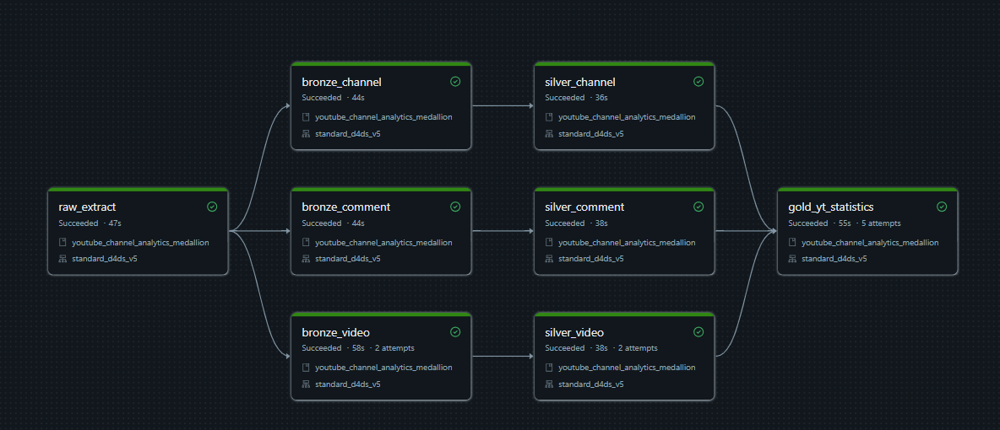

# YouTube Channel Analytics — Medallion Architecture

Projekt pobiera dane z **YouTube Data API v3** dla wybranych kanałów, zapisuje je warstwowo w **Azure Data Lake Storage Gen2** i przetwarza w architekturze **Medallion** (Raw → Bronze → Silver → Gold) na **Azure Databricks** z wykorzystaniem **Unity Catalog**.

Pierwsza wersja projektu znajduje się w repozytorium: [Youtube-medallion-architecture-project](https://github.com/KacprusJeden/Youtube-medallion-architecture-project)

---

## 1. Architektura

Poniżej przedstawiony jest faktyczny workflow joba `load_youtube_data` uruchomiony w Azure Databricks:



Architektura danych opiera się na podejściu **Medallion**:

* **Raw** — surowe odpowiedzi z YouTube API zapisane jako pliki `.jsonl` w ADLS. Każdy kanał, data i run ma własny katalog.
* **Bronze** — dane wczytane z JSONL, z castowaniem typów, deduplikacją (`row_number` po `load_date`) i podstawowym czyszczeniem. Trzy tabele: `channels`, `videos`, `comments`.
* **Silver** — model **Data Vault 2.0**:
  * **Hubs**: `hub_channels`, `hub_videos`, `hub_comments`
  * **Satellites**: `sat_channels`, `sat_videos`, `sat_comments` (historia SCD2 z `valid_from`, `valid_to`, `is_current`, `hash_diff`)
  * **Links**: `link_videos`, `link_comments`
* **Gold** — gotowe do analizy tabele:
  * `youtube_statistics_obt` — One Big Table z wymiarami i metrykami, SCD2
  * `youtube_num_statistics_obt` — snapshot numeryczny partycjonowany po `date_of_data`

Dodatkowo w warstwie `metadata` przechowywana jest tabela `watermark.youtube_api` z historią uruchomień, watermarkami i checkpointami.

---

## 2. Wymagania wstępne

Przed pierwszym uruchomieniem musisz mieć skonfigurowane:

1. **Azure Databricks workspace** z włączonym **Unity Catalog**.
2. **Azure Data Lake Storage Gen2** (storage account z włączonym hierarchicznym przestrzenią nazw — HNS).
3. **Kontenery w ADLS**:
   * `raw`
   * `bronze`
   * `silver`
   * `gold`
   * `metadata`
4. **Uprawnienia**:
   * Tożsamość klastra Databricks (Managed Identity, Service Principal lub Access Connector) musi mieć rolę **Storage Blob Data Contributor** (lub wyższą) na storage account.
   * W Unity Catalog musi istnieć **storage credential** / **external location** umożliwiająca zapis do powyższych kontenerów.
   * Użytkownik/job musi mieć uprawnienia `USE CATALOG`, `USE SCHEMA`, `CREATE TABLE`, `MODIFY` itp.
5. **Databricks CLI** zainstalowane lokalnie i skonfigurowane:
   ```bash
   databricks configure
   ```
6. **Klucz YouTube Data API v3** zapisany w Databricks Secrets.
7. **uv** (menedżer pakietów Python):
   ```bash
   pip install uv
   ```

---

## 3. Konfiguracja infrastruktury Azure

### 3.1. Azure Data Lake Storage Gen2

Utwórz storage account (np. `storageaccountswec001`) i kontenery:

```bash
az storage container create --account-name <nazwa_storage> --name raw
az storage container create --account-name <nazwa_storage> --name bronze
az storage container create --account-name <nazwa_storage> --name silver
az storage container create --account-name <nazwa_storage> --name gold
az storage container create --account-name <nazwa_storage> --name metadata
```

### 3.2. Uprawnienia dla klastra Databricks

Jeśli klaster używa **Managed Identity**:

```bash
# Przypisz rolę Storage Blob Data Contributor do klastra/managed identity
az role assignment create \
  --assignee-object-id <object_id_managed_identity> \
  --role "Storage Blob Data Contributor" \
  --scope /subscriptions/<sub>/resourceGroups/<rg>/providers/Microsoft.Storage/storageAccounts/<nazwa_storage>
```

Jeśli używasz **Service Principal** w konfiguracji klastra, nadaj mu tę samą rolę.

### 3.3. Unity Catalog — storage credential / external location

W Databricks workspace wykonaj (jako admin/catalog owner):

```sql
-- Storage credential dla Managed Identity / SP
CREATE STORAGE CREDENTIAL IF NOT EXISTS adls_youtube_credential
  WITH (
    TYPE = 'MANAGED_IDENTITY',
    AZURE_MANAGED_IDENTITY_CLIENT_ID = '<client_id_managed_identity>'
  );

-- External location do głównej ścieżki projektu
CREATE EXTERNAL LOCATION IF NOT EXISTS adls_youtube_root
  URL 'abfss://raw@<nazwa_storage>.dfs.core.windows.net/'
  WITH (STORAGE CREDENTIAL adls_youtube_credential);

GRANT READ FILES, WRITE FILES ON EXTERNAL LOCATION adls_youtube_root TO `<grupa_lub_użytkownik>`;
```

> W przykładzie powyżej credential wskazuje na kontener `raw`. W produkcji utwórz oddzielne external locations dla każdego kontenera lub jedną dla całego storage account, jeśli Twój model uprawnień na to pozwala.

### 3.4. Secret scope z kluczem YouTube API

W Databricks CLI:

```bash
# Utwórz scope powiązany z Azure Key Vault (zalecane)
databricks secrets create-scope --scope kv-kacprusjeden-swec-001 --resource-id <azure-keyvault-resource-id> --dns-name <keyvault-dns>

# Dodaj klucz API
databricks secrets put --scope kv-kacprusjeden-swec-001 --key YT-API-KEY
```

Wartości `scope` i `key` muszą być zgodne z kodem w `src/youtube_channel_analytics_medallion/raw/extract_api.py`:

```python
self.api_key = dbutils.secrets.get(scope="kv-kacprusjeden-swec-001", key="YT-API-KEY")
```

---

## 4. Tworzenie katalogów i schematów w Unity Catalog

> **Schematy muszą być zlokalizowane w ADLS** (managed location), ponieważ tabele Delta tworzone przez `saveAsTable` są zapisywane w lokalizacji zarządzanej przez schemat.

Wykonaj poniższe polecenia SQL w Databricks notebook lub SQL editor. Zastąp `<nazwa_storage>` nazwą swojego storage account.

```sql
-- =====================================================
-- CATALOGI I SCHEMATY DLA ARCHITEKTURY MEDALLION
-- =====================================================

-- Bronze
CREATE CATALOG IF NOT EXISTS bronze
  MANAGED LOCATION 'abfss://bronze@<nazwa_storage>.dfs.core.windows.net/unity_catalog/bronze';
CREATE SCHEMA IF NOT EXISTS bronze.yt
  MANAGED LOCATION 'abfss://bronze@<nazwa_storage>.dfs.core.windows.net/unity_catalog/bronze/yt';

-- Silver
CREATE CATALOG IF NOT EXISTS silver
  MANAGED LOCATION 'abfss://silver@<nazwa_storage>.dfs.core.windows.net/unity_catalog/silver';
CREATE SCHEMA IF NOT EXISTS silver.yt
  MANAGED LOCATION 'abfss://silver@<nazwa_storage>.dfs.core.windows.net/unity_catalog/silver/yt';

-- Gold
CREATE CATALOG IF NOT EXISTS gold
  MANAGED LOCATION 'abfss://gold@<nazwa_storage>.dfs.core.windows.net/unity_catalog/gold';
CREATE SCHEMA IF NOT EXISTS gold.yt
  MANAGED LOCATION 'abfss://gold@<nazwa_storage>.dfs.core.windows.net/unity_catalog/gold/yt';

-- Metadata (watermark, logi)
CREATE CATALOG IF NOT EXISTS metadata
  MANAGED LOCATION 'abfss://metadata@<nazwa_storage>.dfs.core.windows.net/unity_catalog/metadata';
CREATE SCHEMA IF NOT EXISTS metadata.watermark
  MANAGED LOCATION 'abfss://metadata@<nazwa_storage>.dfs.core.windows.net/unity_catalog/metadata/watermark';
```

Po wykonaniu upewnij się, że użytkownik/job ma uprawnienia:

```sql
GRANT USE CATALOG ON CATALOG bronze TO `<uzytkownik_lub_grupa>`;
GRANT USE SCHEMA ON SCHEMA bronze.yt TO `<uzytkownik_lub_grupa>`;
GRANT CREATE TABLE, MODIFY, SELECT ON SCHEMA bronze.yt TO `<uzytkownik_lub_grupa>`;

-- powtórz dla silver, gold, metadata
```

---

## 5. Tworzenie tabel warstwy Gold

Przed pierwszym uruchomieniem zadania `gold_yt_statistics` **musi istnieć** tabela docelowa w warstwie Gold. Uruchom skrypt:

```sql
-- Wczytaj i wykonaj plik:
-- src/youtube_channel_analytics_medallion/gold/gold_tables.sql
```

Możesz to zrobić w Databricks notebook:

```python
%sql
-- zawartość src/youtube_channel_analytics_medallion/gold/gold_tables.sql

CREATE TABLE IF NOT EXISTS gold.yt.youtube_num_statistics_obt(
    date_of_data DATE,
    run_id VARCHAR(100),
    hk_channel VARCHAR(100),
    hk_video VARCHAR(100),
    hk_comment VARCHAR(100),
    channel_view_count INT,
    channel_subscrb_count INT,
    channel_hidden_subscrb_count INT,
    video_count INT,
    video_view_count INT,
    video_like_count INT,
    video_favorite_count INT,
    video_comment_count INT,
    comment_like_count INT,
    comment_reply_count INT
)
USING DELTA
PARTITIONED BY (date_of_data);

CREATE TABLE IF NOT EXISTS gold.yt.youtube_statistics_obt(
    valid_from DATE,
    valid_to DATE,
    run_id VARCHAR(100),
    hk_channel VARCHAR(100),
    hk_video VARCHAR(100),
    hk_comment VARCHAR(100),
    channel_name VARCHAR(50),
    custom_url VARCHAR(200),
    description VARCHAR(2000),
    channel_publish_date TIMESTAMP,
    video_publish_date TIMESTAMP,
    video_title VARCHAR(100),
    video_description VARCHAR(2000),
    video_category_id INT,
    video_duration VARCHAR(20),
    video_caption BOOLEAN,
    video_dflt_language VARCHAR(4),
    video_dflt_audio_language VARCHAR(4),
    comment_text VARCHAR(2000),
    comment_author VARCHAR(50),
    comment_publish_date TIMESTAMP,
    comment_update_date TIMESTAMP,
    is_public BOOLEAN,
    can_reply BOOLEAN,
    is_current BOOLEAN,
    hash_diff VARCHAR(70)
)
USING DELTA;
```

> Tabela `youtube_statistics_obt` jest nadpisywana/wypełniana przez kod w `load_dms.py`, dlatego jej struktura musi być zgodna z kodem. Jeśli zmienisz schemat w kodzie, zaktualizuj również ten plik SQL.

---

## 6. Co podmienić w konfiguracjach

### 6.1. `databricks.yml`

Zmienne bundle definiują ścieżki ADLS i tabelę watermark. Podmień:

| Element | Co zmienić | Przykład |
|---------|------------|----------|
| `workspace.host` | URL workspace Databricks | `https://adb-XXXX.XX.azuredatabricks.net` |
| `variables.storage_name` | Nazwa storage account | `storageaccountswec001` |
| `variables.data_base_path` | Ścieżka bazowa z placeholderem `LAYER` | `abfss://LAYER@<storage>.dfs.core.windows.net/youtube_api/` |
| `variables.watermark_table` | Pełna nazwa tabeli watermark | `metadata.watermark.youtube_api` |
| `variables.error_path` | Ścieżka do błędów (z placeholderem `LAYER`) | `${var.data_base_path}errors/` |
| `variables.checkpoint_path` | Ścieżka checkpointów streaming | `${var.data_base_path}checkpoint/` |
| `variables.log_path` | Ścieżka logów procesowych | `abfss://metadata@<storage>.dfs.core.windows.net/youtube_api/` |
| `prod.workspace.root_path` | Ścieżka deploymentu prod w workspace | `/Workspace/Users/.../.bundle/${bundle.name}/${bundle.target}` |
| `prod.permissions` | Użytkownik z uprawnieniami CAN_MANAGE | Twój UPN |

> **Ważne:** placeholder `LAYER` w `data_base_path` jest zastępowany w kodzie Python na `raw`, `bronze`, `silver`, `gold` w zależności od warstwy.

### 6.2. `resources/load_youtube_data.job.yml`

Podmień:

* `existing_cluster_id` we wszystkich taskach — ID klastra w Twoim workspace.
* `email_notifications.on_success` / `on_failure` — adresy e-mail.
* Domyślne wartości parametrów (opisane w sekcji 8) jeśli potrzebujesz innych.

### 6.3. Kanały YouTube

Kanały są **twardo zakodowane** w `src/youtube_channel_analytics_medallion/raw/extract.py`:

```python
channels = ["@nieinformatyk", "@DataWithBaraa"]
```

Zmień je na własne handlery kanałów (z `@`) lub identyfikatory kanałów.

### 6.4. Secret scope i klucz API

W `src/youtube_channel_analytics_medallion/raw/extract_api.py`:

```python
self.api_key = dbutils.secrets.get(scope="kv-kacprusjeden-swec-001", key="YT-API-KEY")
```

Dostosuj `scope` i `key` do swojej konfiguracji secrets.

---

## 7. Instalacja zależności lokalnie

```bash
uv sync --dev
```

Aby zbudować wheel (wymagane przy deploymencie):

```bash
uv build --wheel
```

> Wheel ląduje w `dist/*.whl` i jest używany przez zadania Databricks (patrz `libraries.whl: ../dist/*.whl` w `load_youtube_data.job.yml`).

---

## 8. Deployment bundle

Projekt używa **Databricks Asset Bundles** (DAB).

### 8.1. Autentykacja

```bash
databricks configure
```

Wybierz profil i wpisz token dostępowy do workspace.

### 8.2. Deploy dev

```bash
cd youtube_channel_analytics_medallion
uv build --wheel
databricks bundle deploy --target dev
```

`dev` jest targetem domyślnym, więc `--target dev` można pominąć.

### 8.3. Deploy prod

```bash
uv build --wheel
databricks bundle deploy --target prod
```

---

## 9. Uruchamianie pipeline'u

### 9.1. Zadanie `load_youtube_data`

Pipeline składa się z zadań Databricks Job:

| Task | Warstwa | Cel |
|------|---------|-----|
| `raw_extract` | Raw | Pobiera kanały, filmy i komentarze z YouTube API i zapisuje do ADLS |
| `bronze_channel` | Bronze | Wczytuje `channels` z JSONL do Delta |
| `bronze_video` | Bronze | Wczytuje `videos` z JSONL do Delta |
| `bronze_comment` | Bronze | Wczytuje `comments` z JSONL do Delta |
| `silver_channel` | Silver | Buduje Hub i Satellite dla kanałów |
| `silver_video` | Silver | Buduje Hub, Link i Satellite dla filmów |
| `silver_comment` | Silver | Buduje Hub, Link i Satellite dla komentarzy |
| `gold_yt_statistics` | Gold | Łączy dane Silver w OBT i snapshot numeryczny |

### 9.2. Parametry joba

Parametry definiowane są w `resources/load_youtube_data.job.yml`:

| Parametr | Domyślnie | Opis |
|----------|-----------|------|
| `date_of_data` | `""` (dzisiaj UTC) | Data, dla której pobierane są dane. Format `YYYY-MM-DD`. |
| `mode` | `"incremental"` | Tryb przetwarzania: `full`, `incremental`, `reload`, `reload_date`. |
| `reset_checkpoint` | `"false"` | Czy usunąć checkpointy streaming przed startem (`true`/`false`). |
| `start_layer` | `"raw"` | Od której warstwy zacząć: `raw`, `bronze`, `silver`, `gold`. |
| `stop_layer` | `"gold"` | Do której warstwy dojść: `raw`, `bronze`, `silver`, `gold`. |

### 9.3. Tryby pracy

* **`incremental`** — domyślny. Pobiera/przetwarza tylko dane dla podanej `date_of_data`. Dla komentarzy przegląda strony API tylko do napotkania znaku wodnego (`watermark_date`).
* **`full`** — pełne przeładowanie: czyści watermark, truncate'uje tabele Bronze/Silver/Gold, przetwarza wszystkie dostępne daty.
* **`reload`** — podobnie jak `full`, ale nie czyści watermark.
* **`reload_date`** — przeładowuje konkretną datę w modelu SCD2 (zamyka stare wersje i wstawia nowe).

> **Automatyczny wybór trybu:** jeśli `mode` nie zostanie podany (lub `null`), kod w `metadata/mode.py` decyduje: ostatni dzień miesiąca lub pusty watermark → `full`, w przeciwnym razie → `incremental`.

### 9.4. Uruchomienie przez UI

1. W Databricks workspace przejdź do **Workflows > Jobs**.
2. Znajdź job `load_youtube_data` (w dev będzie miał prefiks `[dev <user>] load_youtube_data`).
3. Kliknij **Run now** lub zaplanuj trigger.
4. Aby nadpisać parametry, użyj opcji **Run with parameters**.

### 9.5. Uruchomienie przez CLI

```bash
# Domyślne parametry
databricks bundle run load_youtube_data --target dev
```

Parametry joba (data, tryb, checkpoint itp.) najwygodniej nadpisać w UI przez **Run with parameters** lub tymczasowo zmienić wartości domyślne w `resources/load_youtube_data.job.yml` przed deployem.

> **Uwaga:** w `resources/load_youtube_data.job.yml` parametr końca zakresu nazywa się `stop_layer` i jest przekazywany jako `--stop_layer`, natomiast kod Python w modułach `raw`, `bronze` i `silver` oczekuje `--end_layer`. Jeśli planujesz używać `start_layer`/`stop_layer`, zsynchronizuj nazwę parametru w jobie z kodem (`--end_layer` zamiast `--stop_layer`).

### 9.6. Uruchamianie pojedynczych tasków ręcznie

W notebooku lub workflow możesz uruchomić tylko wybrany moduł, podając jego parametry CLI bezpośrednio. Przykłady:

```bash
# Tylko warstwa Raw
--data_base_path abfss://raw@<storage>.dfs.core.windows.net/youtube_api/ \
--watermark_table metadata.watermark.youtube_api \
--error_path abfss://raw@<storage>.dfs.core.windows.net/youtube_api/errors/ \
--checkpoint_path abfss://raw@<storage>.dfs.core.windows.net/youtube_api/checkpoint/ \
--log_path abfss://metadata@<storage>.dfs.core.windows.net/youtube_api/ \
--run_id <run_id> --task_key raw_extract \
--date_of_data 2024-11-01 --mode incremental

# Tylko Silver dla filmów
--data_base_path abfss://silver@<storage>.dfs.core.windows.net/youtube_api/ \
--watermark_table metadata.watermark.youtube_api \
--error_path abfss://silver@<storage>.dfs.core.windows.net/youtube_api/errors/ \
--checkpoint_path abfss://silver@<storage>.dfs.core.windows.net/youtube_api/checkpoint/ \
--log_path abfss://metadata@<storage>.dfs.core.windows.net/youtube_api/ \
--run_id <run_id> --task_key silver_video \
--date_of_data 2024-11-01 --mode incremental --dataset_type videos
```

---

## 10. Struktura projektu

```
youtube_channel_analytics_medallion/
├── databricks.yml              # Definicja bundle, zmienne, targety dev/prod
├── pyproject.toml              # Zależności Python i entry points
├── README.md                   # Ten plik
├── resources/
│   └── load_youtube_data.job.yml  # Definicja joba Databricks
├── src/youtube_channel_analytics_medallion/
│   ├── config/
│   │   └── app_config.py       # Ładowanie konfiguracji (args / spark.conf)
│   ├── raw/
│   │   ├── extract.py          # Entry point `raw` — orchestracja pobierania
│   │   └── extract_api.py      # Klasa YoutubeData — wywołania API
│   ├── bronze/
│   │   ├── channel.py          # Entry point `bronze_channel`
│   │   ├── video.py            # Entry point `bronze_video`
│   │   ├── comment.py          # Entry point `bronze_comment`
│   │   ├── functions.py        # Funkcje pomocnicze Bronze
│   │   └── schemas.py          # Schematy Bronze
│   ├── silver/
│   │   ├── transform.py        # Entry point `silver_transform`
│   │   ├── functions.py        # Funkcje Silver (Hash, SCD2, wczytywanie danych)
│   │   └── schemas.py          # Schematy Data Vault
│   ├── gold/
│   │   ├── load_dms.py         # Entry point `gold_yt_statistics`
│   │   ├── functions.py        # Funkcje Gold
│   │   └── gold_tables.sql     # SQL tworzący tabele Gold (uruchomić ręcznie)
│   └── metadata/
│       ├── watermark.py        # Watermark, checkpointy, ścieżki ADLS
│       ├── log.py              # Logowanie do plików i ADLS
│       └── mode.py             # Automatyczny wybór trybu full/incremental
└── tests/                      # Testy pytest
```

---

## 11. Testy

```bash
uv run pytest
```

Testy jednostkowe nie wymagają działającego klastra (z wyjątkiem testów oznaczonych markerem `spark`).

---

## 12. Rozwiązywanie typowych problemów

| Problem | Możliwa przyczyna | Rozwiązanie |
|---------|-------------------|-------------|
| `Permission denied` przy zapisie do ADLS | Brak roli Storage Blob Data Contributor dla tożsamości klastra | Nadaj rolę i zrestartuj klaster |
| `table_or_view_not_found` | Nie utworzono catalogu/schematu w UC | Uruchom SQL z sekcji 4 |
| Błąd w tasku Gold (`gold_yt_statistics`) | Nie utworzono tabel Gold | Uruchom `src/youtube_channel_analytics_medallion/gold/gold_tables.sql` |
| `No module named 'googleapiclient'` | Nie zdeployowano nowej wersji wheel | Uruchom `uv build --wheel` i `databricks bundle deploy` |
| `Secret not found` | Niewłaściwy scope/klucz secrets | Sprawdź konfigurację w `extract_api.py` i Databricks Secrets |
| Job nie zatrzymuje się na `stop_layer` | Niespójność nazw `--stop_layer` vs `--end_layer` | Zsynchronizuj nazwę parametru w `resources/load_youtube_data.job.yml` z kodem Python |
| Brak danych dla komentarzy | Komentarze są wyłączone na filmie lub film ma ograniczenia | Jest to normalne — kod loguje ostrzeżenie i kontynuuje |

---

## 13. Rozwój lokalny

Zalecane narzędzia:

* **VS Code** z rozszerzeniem Databricks: https://docs.databricks.com/dev-tools/vscode-ext.html
* **Cursor** lub inny IDE zgodny z Databricks Connect.
* **Databricks Connect** jest już w zależnościach (`databricks-connect`).

Po każdej zmianie kodu:

1. Uruchom testy: `uv run pytest`
2. Przebuduj wheel: `uv build --wheel`
3. Zdeployuj: `databricks bundle deploy --target dev`
4. Uruchom job: `databricks bundle run load_youtube_data --target dev`
